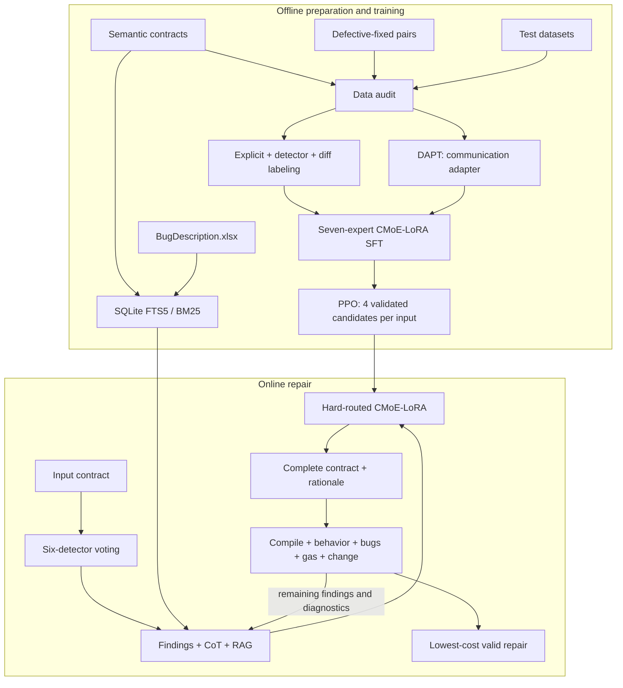

<div align="center">


# AutoMender Engineering Guide

### Training, Inference, Validation, and Reproduction

[](https://www.python.org/)
[](config/default.yaml)
[](automender/models/cmoe_lora.py)
[](automender/validation/)

[Project overview](../README.md) · [Default configuration](config/default.yaml) · [JSON schemas](schemas/) · [Tests](../tests/)

</div>

The `automender` package is the maintained implementation of the AutoMender research artifact. It provides a single command-line interface for data auditing, semantic-domain adaptation, repair fine-tuning, PPO, retrieval, detector aggregation, iterative repair, validation, evaluation, and ablation studies.

Unless a section says otherwise, run the commands below from the repository root.

> **Reproduction policy**
>
> The default `paper` profile fails closed. A missing compiler, detector, behavioral validator, model, or GPU is never interpreted as a successful result. Fake backends exist only in tests and always produce `paper_eligible: false`.

## 🧭 Quick Links

- [🏗️ Architecture](#architecture)
- [🗂️ Package Layout](#package-layout)
- [📦 Installation](#installation)
- [⚙️ Configuration](#configuration)
- [⌨️ CLI Reference](#cli-reference)
- [🔄 End-to-End Workflow](#end-to-end-workflow)
- [🧠 CMoE-LoRA and Training](#cmoe-lora-and-training)
- [🛡️ Detection and Validation](#detection-and-validation)
- [🩹 Repair Loop](#repair-loop)
- [🧪 Experiments](#experiments)
- [✅ Testing and Acceptance](#testing-and-acceptance)
- [🧰 Troubleshooting](#troubleshooting)

## 🏗️ Architecture



## 🗂️ Package Layout

```text
Code/
├── automender/
│   ├── data/              # Solidity tokenization, audit, semantics, pair labeling
│   ├── knowledge/         # SQLite FTS5/BM25 knowledge index
│   ├── detectors/         # Detector contracts, Slither parser, signed ensemble
│   ├── models/            # CMoE-LoRA injection and complete-contract generation
│   ├── training/          # DAPT, SFT, conflict regularization, incremental SFT, PPO
│   ├── validation/        # solc, behavior adapter, DTW/Levenshtein, repair cost
│   ├── pipeline/          # Prompt construction and three-round repair algorithm
│   ├── experiments/       # Metrics, baselines, matrix generation and execution
│   ├── cli.py             # Unified `automender` CLI
│   ├── config.py          # Defaults, YAML merge, and environment injection
│   ├── taxonomy.py        # 24 bug IDs mapped to seven expert categories
│   └── types.py           # Stable serializable artifact types
├── config/
│   ├── default.yaml       # Strict Qwen2-7B paper profile
│   ├── llama3-8b.yaml
│   ├── deepseek-coder-7b.yaml
│   └── smoke-test.yaml
├── schemas/               # JSON Schema definitions for public artifacts
├── pyproject.toml
├── requirements.txt
├── requirements-train.txt
└── requirements-dev.txt
```

The historical `preprocess.py`, `repair.py`, and `validate.py` files are compatibility wrappers. New workflows should use `automender` or `python -m automender`.

## 📦 Installation

### Runtime Only

```bash
python -m venv .venv
source .venv/bin/activate
python -m pip install --upgrade pip
pip install -e Code
```

### Training and Development

```bash
pip install -e 'Code[train]'
pip install -e 'Code[dev]'
```

The training extra installs PyTorch, Transformers, Accelerate, and Safetensors. Third-party Solidity analyzers and model weights must be installed separately.

## ⚙️ Configuration

The default profile is [config/default.yaml](config/default.yaml). Alternative profiles extend that file, so detector, optimizer, and validation settings remain consistent.

```bash
# Global options must precede the subcommand.
automender --config Code/config/default.yaml doctor
automender --config Code/config/smoke-test.yaml doctor
```

### Data-Path Environment Variables

| Variable | Meaning |
|---|---|
| `AUTOMENDER_SEMANTIC_DIR` | Clean semantic Solidity corpus |
| `AUTOMENDER_PAIRS_CSV` | CSV containing `vulnerable` and `fixed` columns |
| `AUTOMENDER_TEST1_DIR` | Dataset1 contract directory |
| `AUTOMENDER_TEST2_DIR` | Dataset2 contract directory |
| `AUTOMENDER_TEST3_DIR` | Dataset3 contract directory |
| `AUTOMENDER_OUTPUT_DIR` | Preferred run-output directory |
| `AUTOMENDER_MODEL` | Local model directory or model identifier override |

Example:

```bash
export AUTOMENDER_SEMANTIC_DIR=/data/contracts/sourcecodes
export AUTOMENDER_PAIRS_CSV=/data/contracts/paired-smart-contracts.csv
export AUTOMENDER_TEST1_DIR=/data/contracts/Dataset1_Test
export AUTOMENDER_TEST2_DIR=/data/contracts/Dataset2
export AUTOMENDER_TEST3_DIR=/data/contracts/Dataset3
export AUTOMENDER_OUTPUT_DIR=/data/automender-runs
```

No machine-specific path is stored in a tracked configuration file.

## ⌨️ CLI Reference

| Command | Purpose | Principal artifact |
|---|---|---|
| `doctor` | Check Python, GPU, model, `solc`, behavior backend, and six detectors | JSON diagnostic |
| `audit-data` | Enforce corpus scale and whole-contract non-overlap | `data_audit.json` |
| `prepare-semantic` | Extract hashes and contract semantics | manifest JSONL |
| `label-pairs` | Generate auditable labels and grouped 95/5 splits | repair JSONL + report |
| `build-index` | Build the deduplicated FTS5/BM25 index | SQLite database |
| `train-dapt` | Continue domain training of communication LoRA | adapter checkpoint |
| `train-sft` | Train repair experts and shared adapter | adapter checkpoint |
| `train-ppo` | Optimize validated complete-contract trajectories | adapter + value head |
| `repair` | Run detector-guided iterative repair | Solidity file + report |
| `validate` | Evaluate an original/repaired pair | quality report |
| `evaluate` | Aggregate per-contract outcomes | per-seed and summary tables |
| `ablate` | Generate or execute the experiment matrix | immutable run definitions |

Use `automender <command> --help` for command-specific options.

## 🔄 End-to-End Workflow

### 1. 🩺 Environment Diagnosis

```bash
automender doctor
```

In the strict profile, this command exits non-zero unless the complete paper environment is available. A typical CPU development machine is expected to fail the paper-readiness check while still being able to run unit tests.

### 2. 🛡️ Mandatory Data Audit

```bash
automender audit-data --output runs/data_audit.json
```

The audit enforces the declared semantic corpus:

| Property | Required value |
|---|---:|
| Solidity files | 73,391 |
| Total bytes | 1,075,736,361 |
| Dataset1 whole-contract overlap | 0 |
| Dataset2 whole-contract overlap | 0 |
| Dataset3 whole-contract overlap | 0 |

Each overlap is checked at the byte, normalized-text, and normalized-token levels. Paired samples are also compared against complete test contracts. Internal pair/fragment reuse is reported without deleting rows; a joint normalized-token fingerprint keeps repeated pairs in the same split.

All three training commands invoke this audit automatically.

### 3. 🧱 Semantic Manifest

```bash
automender prepare-semantic \
  --source "$AUTOMENDER_SEMANTIC_DIR" \
  --output runs/semantic
```

The generated manifest includes relative paths, byte counts, SHA-256 hashes, normalized-token hashes, contracts, inheritance, state variables, functions, modifiers, call relations, and dangerous operations.

### 4. 🏷️ Pair Labeling

```bash
automender label-pairs \
  --csv "$AUTOMENDER_PAIRS_CSV" \
  --manifest explicit_labels.jsonl \
  --detector-evidence detector_findings.jsonl \
  --output runs/pairs
```

Label precedence and confidence rules are:

1. an explicit label manifest has highest priority;
2. two distinct detectors supporting the same category produce a high-confidence label;
3. one exact repair rule matching an added diff line also produces a high-confidence label;
4. low-confidence or unlabeled pairs remain in SFT but activate only communication LoRA.

The explicit manifest and detector-evidence arguments are optional. Without them, exact diff rules provide the initial weak labels. `label_report.json` records per-expert counts, evidence sources, internal duplicate fingerprints, low-confidence ratio, multi-label samples, and split sizes.

### 5. 🔎 Knowledge Index

```bash
automender build-index \
  --output runs/knowledge.sqlite \
  --semantic "$AUTOMENDER_SEMANTIC_DIR" \
  --bug-description-xlsx Bug_examples/BugDescription.xlsx
```

Bug/category matches are ranked before general semantic results. The index folds internal documents with the same normalized-token hash, while DAPT continues to use all 73,391 declared files.

## 🧠 CMoE-LoRA and Training

### Seven Fixed Experts

| Expert | Representative bug IDs |
|---|---|
| Reentrancy | `RE`, `REN`, `REE` |
| Arithmetic | `IO` |
| Unchecked calls | `UCL`, `UCS` |
| Optimized operations | `ST`, `CNE`, `RR`, `UUS`, `EGL`, `RDS`, `BE`, `AIB`, `CS`, `RTS`, `EF`, `COL` |
| Access control | `SU`, `AS`, `TO` |
| Transaction dependence | `TOD` |
| Block dependence | `TS`, `BP` |

For every target linear layer, the implementation computes:

```text
base(x) + sum(active expert deltas) + lambda_comm * communication_delta(x)
```

There is no learned router and no top-k gate. Multiple labels activate multiple experts; inactive experts do not participate in the forward pass and receive no gradient.

### Default Optimization Settings

| Parameter | DAPT | Repair SFT | PPO |
|---|---:|---:|---:|
| Epochs | 1 | 3 | 4 per update |
| Learning rate | 2e-4 | 2e-4 | 1e-5 |
| Effective batch | 32 | 32 | 32 |
| Candidates per input | — | — | 4 |

Shared defaults are LoRA rank 8, alpha 32, dropout 0.1, sequence length 3072, AdamW betas `(0.9, 0.999)`, epsilon `1e-8`, zero weight decay, 3% linear warmup, and gradient clipping at 1.0.

### DAPT

```bash
automender train-dapt --output runs/qwen-dapt
```

The backbone and all category experts remain frozen. Only communication LoRA is updated.

### Repair SFT

```bash
automender train-sft \
  --samples runs/pairs/repair_samples.jsonl \
  --initial-adapters runs/qwen-dapt \
  --save-communication-gradients runs/qwen-sft/communication_gradients.pt \
  --output runs/qwen-sft
```

For a multi-label sample, conflict regularization is computed only for pairs of experts co-active in that sample. The total loss is:

```text
L_total = L_repair + 0.1 * mean(max(0, -cos(g_i, g_j)))
```

Training reports the mean gradient cosine and conflict rate used by the communication/conflict ablation.

### Incremental Category Training

```bash
automender train-sft \
  --samples runs/pairs/repair_samples.jsonl \
  --initial-adapters runs/qwen-sft \
  --new-category block_dependence \
  --reference-gradients runs/qwen-sft/communication_gradients.pt \
  --reg-alpha 1.0 \
  --output runs/qwen-incremental
```

Only the new category expert and communication adapter are trainable. Existing experts and the backbone stay frozen; the saved communication-gradient reference implements the incremental drift regularizer.

### PPO

```bash
automender train-ppo \
  --rollouts runs/real_rollouts.jsonl \
  --initial-adapters runs/qwen-sft \
  --output runs/qwen-ppo
```

Every `group_id` must contain exactly four complete repair candidates. A rollout row contains at least:

```json
{
  "group_id": "contract-001",
  "prompt": "...",
  "completion": "<repaired_contract>...</repaired_contract><repair_rationale>...</repair_rationale>",
  "expert_labels": ["reentrancy"],
  "quality": {"valid": true, "total_cost": 12.5},
  "reward": 0.0740740741,
  "paper_eligible": true
}
```

Invalid candidates receive `-1`; a valid candidate receives `1 / (1 + Ω)`. Paper mode rejects fake artifacts, incomplete contracts, group sizes other than four, and rewards inconsistent with the quality record.

## 🛡️ Detection and Validation

### Detector Protocol

SmartFast, VulHunter, RSymX, Securify, and ILF use strict command/JSON adapters. Slither uses its native JSON format. A generic detector must emit either a list or an object containing `findings`:

```json
{
  "findings": [
    {
      "bug_type": "RE",
      "path": "input.sol",
      "line_start": 42,
      "line_end": 47,
      "function": "withdraw",
      "confidence": 1.0,
      "evidence": "external value call precedes the state update"
    }
  ]
}
```

Detector states are explicit: `success`, `unavailable`, `timeout`, `error`, or `unsupported`. A positive report uses the configured positive weight. A negative weight is used only when a detector successfully ran and supports that bug type. Every other state is neutral; strict paper mode rejects incomplete toolchains.

The 24-type support matrix and signed implementation defaults are defined in [`../Detection_weights/default.yaml`](../Detection_weights/default.yaml).

### Compilation

The compiler is selected from a manifest override or Solidity pragma and invoked as:

```text
solc --optimize --gas --bin contract.sol
```

A missing compiler, unavailable requested version, timeout, or compilation error never returns success. Gas estimates and binary generation are requested in the same compiler invocation and retained in the validation artifact.

### Behavioral Validation

The external behavior adapter receives the original contract, repaired contract, and a validation-case manifest. Every returned case must identify one of two oracle types:

- `repair-invariant`: observable behavior and relevant state transitions must be preserved;
- `repair-sensitive`: the repaired outcome may change, but the declared security/business property must hold.

Example manifest:

```json
{
  "cases": [
    {
      "id": "authorized-withdrawal",
      "oracle": "repair-invariant",
      "property": "authorized withdrawal preserves the original output and state transition",
      "inputs": {"caller": "owner", "amount": 1}
    },
    {
      "id": "reentrant-withdrawal",
      "oracle": "repair-sensitive",
      "property": "a nested withdrawal cannot transfer more than the recorded balance"
    }
  ]
}
```

The formal schema is [schemas/validation-cases.schema.json](schemas/validation-cases.schema.json).

### Repair-Quality Cost

A candidate is valid only when it has no residual or newly introduced supported bug and both compilation and behavior checks pass. Valid candidates are ranked by:

```text
positive_gas_increase + 0.5 * Solidity_token_distance
```

The default distance is DTW with binary token mismatch. The sensitivity experiment replaces it with normalized-token Levenshtein distance. Invalid candidates receive cost `10,000`; a valid candidate below `5,000` may stop the online loop early.

## 🩹 Repair Loop

The required model output is:

```text
<repaired_contract>
pragma solidity ...;
...complete repaired source...
</repaired_contract>
<repair_rationale>
Explain each modification and why the intended behavior is preserved.
</repair_rationale>
```

Fragments, empty/no-op repairs, or uncompilable contracts are invalid. Generated text is never appended to the original source.

```bash
automender repair \
  --contract input.sol \
  --validation-manifest validation_cases.json \
  --adapters runs/qwen-ppo \
  --index runs/knowledge.sqlite \
  --output runs/repaired.sol \
  --report runs/repair.json
```

At every iteration, AutoMender re-runs detection and validation, adds remaining findings and diagnostic failures to the next prompt, and retains the lowest-cost valid candidate. The loop stops after at most three rounds. If no valid candidate exists, it returns the latest candidate, remaining findings, and complete diagnostics.

Standalone validation is available with:

```bash
automender validate \
  --original input.sol \
  --repaired runs/repaired.sol \
  --validation-manifest validation_cases.json \
  --output runs/validation.json
```

## 🧪 Experiments

Generate the immutable experiment matrix:

```bash
automender ablate --output runs/ablation_matrix.json
```

The 30 unique configurations cover:

- Base, LoRA, MoE-LoRA, MoE-LoRA+CoT, MoE-LoRA+CoT+RL, and full AutoMender;
- communication/conflict on/off combinations;
- DTW and normalized-token Levenshtein;
- seeds 42, 3407, and 2025.

Execute every configuration with a shell-free command template:

```bash
automender ablate \
  --output runs/ablation \
  --command-template 'python experiment_driver.py --config {config} --output {run_dir}'
```

Available placeholders include `{config}`, `{run_dir}`, `{system}`, `{seed}`, and `{run_id}`. Each directory receives its resolved YAML and orchestration record.

Aggregate per-contract JSONL outcomes:

```bash
automender evaluate \
  --results runs/per_contract.jsonl \
  --output runs/tables.json
```

The output contains IoU, precision, recall, F1, mean time, and peak GPU memory by system, seed, overall result, severity, bug type, and multi-bug status, followed by cross-seed means and standard deviations.

External repair systems use `ExternalBaselineAdapter`; AutoMender does not replace, reimplement, or fabricate their native results.

## 🗃️ Run Artifacts

Training creates adapter weights, metrics, and a manifest similar to:

```text
runs/qwen-sft/
├── adapters.pt
├── adapter_config.json
├── training_metrics.json
└── run_manifest.json
```

The manifest records the git commit and dirty-state summary, complete resolved configuration, dependency versions, model identifier, data audit/fingerprints, detector/compiler versions, random seed, paper eligibility, and checkpoint lineage.

Public serialized types and their schemas include:

- `Finding` and `DetectionRun`;
- `ContractSemantics`;
- `RepairSample`;
- `RepairCandidate`;
- `QualityBreakdown`; and
- `RepairResult`.

## ✅ Testing and Acceptance

Run the deterministic CPU suite:

```bash
PYTHONDONTWRITEBYTECODE=1 \
PYTHONPATH=Code \
python -m unittest discover -s tests -v
```

The suite covers taxonomy, explicit-label precedence, communication-only samples, hard routing, shared adapters, inactive gradients, conflict regularization and second-order backward, vote signs and tool states, distance/cost/reward formulas, complete-contract parsing, compiler failure, toy DAPT→SFT→PPO updates, iterative repair, and early stopping.

### Paper-Level Acceptance

A run is paper-eligible only when all of the following hold:

- the audited corpus is exactly 73,391 files and 1,075,736,361 bytes;
- every whole-contract test-overlap count is zero;
- Qwen2-7B has completed DAPT, SFT, and PPO;
- all six real detectors and matching `solc` versions are available;
- behavior validation uses real repair-invariant/repair-sensitive cases;
- all three seeds and declared ablations have immutable artifacts.

Passing the CPU suite demonstrates implementation consistency, not reproduction of manuscript percentages.

## 🧰 Troubleshooting

### `doctor` Reports `paper_ready: false`

Read the individual check entries. A CPU-only machine without Qwen2-7B and external analyzers is suitable for tests but not for a paper run. Do not switch to the smoke profile for final measurements.

### `solc` Exists but Compilation Is Unavailable

A `solc-select` shim may be installed without an active compiler version. Install the version required by the contract pragma and verify it directly:

```bash
solc-select install 0.8.20
solc-select use 0.8.20
solc --version
```

### Training Stops at the Audit

Inspect `data_audit.json`. Count/size mismatches usually indicate the wrong semantic directory. A non-zero overlap requires removing the complete overlapping contract from the training corpus; partial public-code reuse is not a whole-contract leak and remains separately reported.

### A Detector Reports No Findings but Contributes No Negative Vote

Check its `status`. Only `success` plus declared support for the relevant bug type permits a negative vote. `unavailable`, `timeout`, `error`, and unsupported types are neutral by design.

### PPO Rollout Is Rejected

Confirm that every group contains four candidates, every completion contains a complete tagged Solidity contract, `paper_eligible` is true, and `reward` exactly matches the stored quality record.

## 👩‍💻 Development Notes

- Keep training data, checkpoints, detector outputs, and run directories outside Git.
- Add new public artifact fields to both `automender/types.py` and the relevant JSON schema.
- Add a detector only through the strict status/findings/runtime/raw-artifact contract.
- Preserve the hard-routing invariant: no learned router and no top-k approximation.
- Never mark fake or incomplete validation as paper-eligible.
