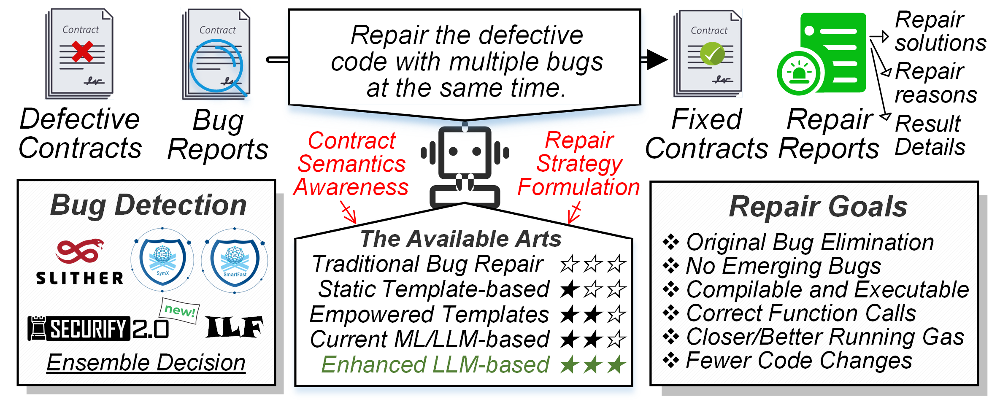
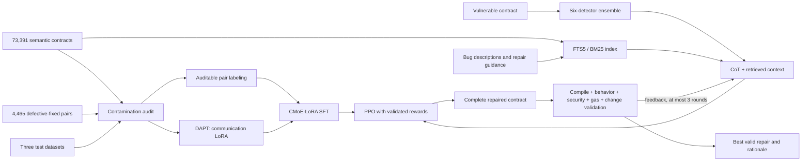

<div align="center">


# AutoMender

### LLM-based Automated Smart Contract Repair

**Retrieval-Augmented Generation · CMoE-LoRA · PPO · Multi-Detector Validation**

[](https://www.python.org/)
[](https://soliditylang.org/)
[](Code/README.md)
[](#license)



</div>

AutoMender is a research framework for automatically repairing Solidity smart contracts. It combines domain-adapted language models, retrieval-augmented repair knowledge, seven hard-routed LoRA experts, PPO optimization, and validation by multiple security analyzers, compilation, behavioral oracles, gas cost, and token-level change distance.

This repository provides the implementation and public evaluation material associated with the manuscript. It does **not** bundle the large external training corpora, trained 7B checkpoints, or third-party detector binaries. Paper-level results must be regenerated in an environment containing the audited data, real model, and complete toolchain.

## 🧭 Quick Links

[✨ Highlights](#highlights) · [🧩 System Overview](#system-overview) · [🛡️ Data Integrity](#data-declarations-and-leakage-policy) · [🚀 Quick Start](#quick-start) · [🧰 Engineering Guide](Code/README.md) · [✅ Verification](#verification)

## ✨ Highlights

| Capability | Implementation |
|---|---|
| Data integrity | Byte-, normalized-text-, and normalized-token whole-contract contamination audit |
| Domain adaptation | Causal-LM continued training over the cleaned Solidity semantic corpus |
| Repair knowledge | SQLite FTS5/BM25 index over bug guidance and contract semantics |
| Specialized repair | Seven label-routed LoRA experts plus a shared communication adapter |
| Multi-bug learning | Simultaneous expert activation with gradient-conflict regularization |
| Outcome optimization | PPO using the paper's bounded repair-quality reward |
| Detection | Signed voting over SmartFast, VulHunter, RSymX, Slither, Securify, and ILF |
| Validation | `solc`, behavioral oracles, residual/new bug checks, gas delta, and code distance |
| Iterative repair | Up to three rounds, retaining the valid candidate with the lowest cost |
| Reproducibility | Three seeds, component/communication/distance ablations, and immutable run manifests |

## 🧩 System Overview



## 🗂️ Repository Layout

```text
AutoMender/
├── Code/
│   ├── automender/           # Maintained Python package and unified CLI
│   ├── config/               # Paper, alternative-model, and smoke profiles
│   ├── schemas/              # Stable JSON schemas for artifacts
│   └── README.md             # Detailed engineering and reproduction guide
├── Detection_weights/        # Signed voting support matrix for 24 bug types
├── Bug_examples/             # Bug descriptions and repair recommendations
├── Dataset1/                 # Curated evaluation contracts
├── Wild_instances/           # On-chain evaluation contracts
├── Security_incidents/       # Historical incident contracts
└── tests/                    # Deterministic CPU unit and fake-backend tests
```

## 🛡️ Data Declarations and Leakage Policy

| Training resource | Declared scale | Use |
|---|---:|---|
| Clean semantic corpus | 73,391 contracts; 1,075,736,361 bytes + 3 GB other files (not used) | DAPT and RAG |
| Defective-fixed pairs | 4,465 rows | Weak labeling and repair SFT |

Before any training command, AutoMender verifies the semantic corpus count and byte size and compares it with all three test datasets using:

1. exact file bytes;
2. line-ending/BOM-normalized text; and
3. comment-insensitive normalized Solidity tokens.

All three whole-contract overlap counts must be zero. A complete vulnerable or fixed training sample that equals a complete test contract also causes a hard failure. Repeated or locally reused fragments **inside the paired training corpus are reported but retained**; their joint pair fingerprint guarantees that duplicate pairs cannot cross the train/validation split.

## 🚀 Quick Start

### 1. 📦 Install

Python 3.10 or newer is required for training and paper runs.

```bash
git clone https://github.com/S-martTools/AutoMender.git
cd AutoMender

python -m venv .venv
source .venv/bin/activate
python -m pip install --upgrade pip
pip install -e 'Code[train,dev]'
```

### 2. ⚙️ Configure External Data

Machine-specific paths are injected through the CLI, YAML, or environment variables and are never hard-coded in the repository.

```bash
export AUTOMENDER_SEMANTIC_DIR=/path/to/clean/sourcecodes
export AUTOMENDER_PAIRS_CSV=/path/to/paired-smart-contracts.csv
export AUTOMENDER_TEST1_DIR=/path/to/Dataset1_Test
export AUTOMENDER_TEST2_DIR=/path/to/Dataset2
export AUTOMENDER_TEST3_DIR=/path/to/Dataset3
export AUTOMENDER_OUTPUT_DIR=/path/to/runs
```

### 3. 🩺 Check the Environment and Data

```bash
automender doctor
automender audit-data --output runs/data_audit.json
```

The default profile is intentionally strict. Missing models, GPU support, compilers, detectors, or the behavioral backend are reported as failures rather than silently treated as successful checks.

### 4. 🧱 Prepare Training Artifacts

```bash
automender prepare-semantic --output runs/semantic

automender label-pairs \
  --output runs/pairs

automender build-index \
  --output runs/knowledge.sqlite \
  --semantic "$AUTOMENDER_SEMANTIC_DIR" \
  --bug-description-xlsx Bug_examples/BugDescription.xlsx
```

### 5. 🧠 Train

```bash
automender train-dapt --output runs/qwen-dapt

automender train-sft \
  --samples runs/pairs/repair_samples.jsonl \
  --initial-adapters runs/qwen-dapt \
  --output runs/qwen-sft

automender train-ppo \
  --rollouts runs/real_rollouts.jsonl \
  --initial-adapters runs/qwen-sft \
  --output runs/qwen-ppo
```

### 6. 🛠️ Repair and Validate

```bash
automender repair \
  --contract input.sol \
  --validation-manifest validation_cases.json \
  --adapters runs/qwen-ppo \
  --index runs/knowledge.sqlite \
  --output runs/repaired.sol \
  --report runs/repair.json

automender validate \
  --original input.sol \
  --repaired runs/repaired.sol \
  --validation-manifest validation_cases.json \
  --output runs/validation.json
```

For configuration details, rollout formats, detector contracts, incremental training, and ablations, see the [Code documentation](Code/README.md).

## ✅ Verification

CPU tests use toy models and explicitly non-paper fake backends. They verify algorithms and integration behavior without claiming to reproduce manuscript scores.

```bash
PYTHONDONTWRITEBYTECODE=1 \
PYTHONPATH=Code \
python -m unittest discover -s tests -v
```

## 🔬 Reproducibility Boundary

- A fake-backend result is always marked `paper_eligible: false`.
- Missing or timed-out detectors cannot cast negative votes.
- A PPO rollout is accepted in the paper profile only when it contains a complete contract, a real validation artifact, and a reward consistent with Eq. 16.
- Manuscript tables require Qwen2-7B checkpoints, all six real detectors, the matching Solidity compiler, behavioral validation, three seeds, and complete run manifests.
- The repository does not promise the manuscript percentages unless those artifacts are present and the reproduced measurements support them.

## 📄 License

Unless otherwise stated, the code and data in this repository are provided for academic research use. Third-party models, analyzers, and datasets remain subject to their respective licenses.

## 🙏 Acknowledgments

We thank the developers of Solidity, Slither, Securify, and the broader smart-contract security community, as well as the maintainers of the public datasets used in the evaluation.
